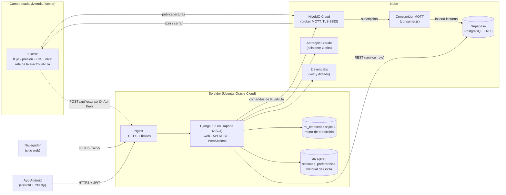
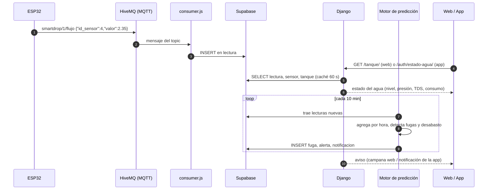
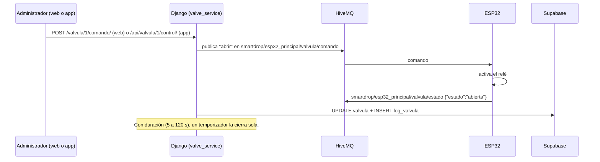
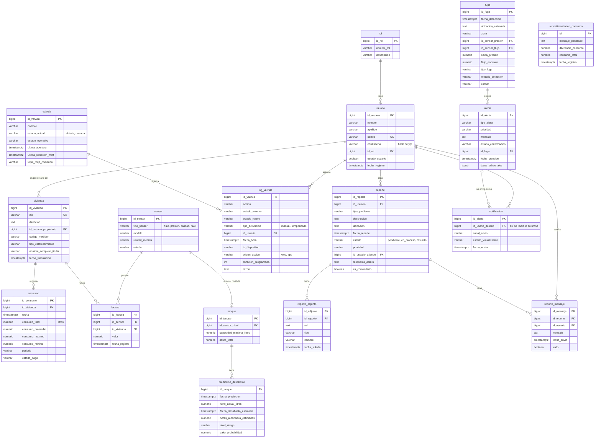

# SmartDrop — Manual técnico

Documentación para mantener, actualizar o escalar SmartDrop sin depender del equipo original (PB013).

| | |
|---|---|
| **Repositorio web y API** | `FS-Robert/SmartDrop` (Django) |
| **Repositorio app** | `alebaires30/SmartDrop-App` (Android, Java) |
| **Firmware** | `SmartDrop_Sistema_Completo.ino` (ESP32), fuera de los repositorios |
| **Última revisión** | 25/10/2026 |

## Contenido

1. [Arquitectura general](#1-arquitectura-general)
2. [Stack tecnológico](#2-stack-tecnológico)
3. [Flujo de datos](#3-flujo-de-datos)
4. [Modelo de datos (diagrama ER)](#4-modelo-de-datos-diagrama-er)
5. [API Documentation](#5-api-documentation)
6. [Deployment](#6-deployment)
7. [Configuración del ESP32](#7-configuración-del-esp32)
8. [Troubleshooting](#8-troubleshooting)
9. [Documentación del código fuente](#9-documentación-del-código-fuente)
10. [Seguridad](#10-seguridad)
11. [Pruebas](#11-pruebas)

---

## 1. Arquitectura general

SmartDrop tiene cuatro piezas: los **sensores** (un ESP32 por vivienda o sector), un **broker MQTT** en la nube, el
**backend Django** (que sirve la página web y la API de la app) y **Supabase** (PostgreSQL), donde vive la información.
La web y la app nunca hablan directo con Supabase: todo pasa por el backend.



**Componentes**

| Componente | Qué hace | Dónde está |
|---|---|---|
| ESP32 | Lee los 4 sensores cada pocos segundos, publica por MQTT y abre o cierra la electroválvula cuando recibe un comando | `SmartDrop_Sistema_Completo.ino` |
| HiveMQ Cloud | Broker MQTT con TLS. Recibe las lecturas y reparte los comandos | Servicio externo |
| Consumidor MQTT | Se suscribe a los topics de lecturas y las guarda en la tabla `lectura` | `consumer.js` (Node.js, fuera del repo) |
| Backend Django | Página web (plantillas), API REST para la app (DRF + JWT), WebSockets en tiempo real (Channels), motor de predicción (`ml_engine`) y la asistente Gotita | Repo web, carpeta `SmartDrop/` |
| Supabase | Base de datos principal (usuarios, viviendas, lecturas, alertas, reportes, válvulas) | Servicio externo |
| App Android | Cliente para usuarios y administradores | Repo app |

## 2. Stack tecnológico

| Capa | Tecnología | Versión |
|---|---|---|
| Firmware | ESP32 (Arduino), `WiFiClientSecure`, `PubSubClient` | — |
| Mensajería | MQTT sobre TLS (HiveMQ Cloud), `paho-mqtt` en Python | paho-mqtt 2.1.0 |
| Backend | Python, Django, Django REST Framework, SimpleJWT, Channels + Daphne (ASGI) | Python 3.13, Django 5.2 |
| Base de datos principal | Supabase (PostgreSQL) por su API REST (PostgREST), con Row Level Security | — |
| Bases locales | SQLite: `db.sqlite3` (Django) y `ml_timeseries.sqlite3` (predicción); se puede pasar a Postgres con `ML_TIMESERIES_DB_*` | — |
| Predicción | pandas, NumPy, scikit-learn, LightGBM | ver `requirements.txt` |
| Asistente Gotita | Anthropic SDK (Claude Sonnet), ElevenLabs (voz y dictado) | anthropic 2.2.0 |
| Web | Plantillas de Django, CSS propio, Chart.js 4.4 | — |
| App | Android (Java), Retrofit, OkHttp, Material Components | compileSdk 35, minSdk 24 |
| Servidor | Ubuntu (Oracle Cloud Always Free), Nginx, Let's Encrypt (certbot), systemd | — |
| Reportes | openpyxl (Excel) | 3.1.5 |

> Nota: los criterios de PB013 mencionan PM2 o Docker. SmartDrop **no** usa ninguno de los dos: el backend corre con
> Daphne como servicio de systemd detrás de Nginx (ver [Deployment](#6-deployment)).

## 3. Flujo de datos

### 3.1 De los sensores al usuario



* **Lecturas directas por HTTP:** el ESP32 también puede mandar lecturas a `POST /api/lecturas/` con la cabecera
  `X-Api-Key`; Django las guarda en `lectura` y las reparte por WebSocket (`/ws/sensors/`) a las pantallas abiertas.
* **Consumo:** cada día se toma el consumo registrado en la tabla `consumo`; si un día no tiene registro, se estima
  integrando las lecturas del sensor de flujo (L/min).
* **Predicción:** `ml_engine` copia las lecturas a `ml_timeseries.sqlite3` y calcula, por hora y vivienda, el consumo, las
  posibles fugas y el riesgo de desabasto. Cuando detecta una fuga, crea `fuga`, `alerta` y `notificacion` en Supabase.

### 3.2 Comando de la electroválvula



### 3.3 Asistente Gotita

La web o la app mandan la pregunta, el texto de la pantalla y, si hace falta, una captura a `/asistente/turno/` (web)
o `/api/asistente/turno/` (app). El servidor agrega los datos de la vivienda, le pregunta a Claude y devuelve la
respuesta **frase por frase** (Server-Sent Events). La voz se genera en `/asistente/voz/` (ElevenLabs) y el dictado en
`/asistente/dictado/`. Las llaves de Anthropic y ElevenLabs solo existen en el `.env` del servidor.

## 4. Modelo de datos (diagrama ER)

### 4.1 Supabase (base principal)

Las tablas marcadas con † no están en `SmartDrop/supabase/schema.sql`: sus columnas son las que usa el código.



† `sensor`, `lectura`, `tanque`, `valvula`, `log_valvula`, `fuga`, `alerta`, `notificacion` y `prediccion_desabasto`.

### 4.2 Bases locales del servidor

| Base | Tablas propias | Para qué |
|---|---|---|
| `db.sqlite3` (alias `default`) | `App_usuario` (copia local de la cuenta para la sesión web), `preferencias_usuario`, `gotita_conversacion`, `gotita_mensaje`, `ajuste_comunidad`, sesiones de Django, lista negra de JWT | Sesiones y datos propios del backend |
| `ml_timeseries.sqlite3` (alias `timeseries`) | `ml_zone`, `ml_home`, `ml_sensor_reading`, `ml_consumption_aggregate`, `ml_model_artifact`, predicciones y estado del monitor | Motor de predicción; el enrutador está en `ml_engine/routers.py` |

## 5. API Documentation

**Base:** `https://<dominio>/` (en desarrollo, `http://127.0.0.1:8000/`). Todas las respuestas son JSON salvo las que se
indican. Los errores tienen la forma `{"error": "mensaje en español"}` (o `{"ok": false, "error": "..."}`).

**Autenticación**

* **App (JWT):** `POST /auth/login/` devuelve `access` (dura 15 minutos) y `refresh`. Cada petición lleva
  `Authorization: Bearer <access>`. Para renovarlo: `POST /auth/refresh/`.
* **Web:** sesión de Django por cookie y cabecera `X-CSRFToken` en los POST.
* **ESP32:** cabecera `X-Api-Key: <LECTURAS_API_KEY>`.

**Códigos de respuesta comunes**

| Código | Significado |
|---|---|
| 200 / 201 | Correcto / creado |
| 400 | Datos inválidos (el mensaje dice cuál) |
| 401 | Sin sesión o token vencido |
| 403 | Sin permiso (por ejemplo, un usuario común en una ruta de administrador) |
| 404 | No existe |
| 413 | Petición demasiado grande (máximo 2,5 MB) |
| 429 | Demasiadas peticiones; la cabecera `Retry-After` dice cuántos segundos esperar |
| 502 / 503 | Supabase, MQTT o un servicio externo no respondió |

La colección de Postman con todos los endpoints está en
[`docs/SmartDrop.postman_collection.json`](SmartDrop.postman_collection.json) (importar en Postman → *Import*). Usa
las variables `base_url`, `access`, `refresh` y `lecturas_api_key`; el login guarda los tokens solo.

### 5.1 Cuenta y sesión (app)

| Método | Ruta | Parámetros | Respuesta |
|---|---|---|---|
| POST | `/auth/registro/` | `{nombre, apellido, correo, contrasena}` | 201 `{mensaje, id_usuario}` · 400 datos inválidos o contraseña débil · 409 el correo ya existe |
| POST | `/auth/login/` | `{correo, contrasena}` | 200 `{mensaje, access, refresh, id_rol, nombre_rol, …}` · 400 correo o contraseña incorrectos · 429 tras 10 intentos fallidos (15 min) · 503 Supabase no responde |
| POST | `/auth/refresh/` | `{refresh}` | 200 `{access, refresh}` · 400 falta el token · 401 vencido o cuenta desactivada |
| POST | `/auth/logout/` | `{refresh}` | 200 `{mensaje}` (anula el token de renovación) |
| GET | `/auth/me/` | — | 200 datos de la cuenta |
| GET / PATCH | `/auth/perfil/` | PATCH: `{nombre, apellido, correo}` | 200 `{ok, mensaje, perfil}` · 400 · 409 correo en uso |
| GET / PATCH | `/auth/preferencias/` | PATCH: `{alertas_nivel, suministro, calidad, consumo_elevado, modo_oscuro, idioma, reportes_semanales}` | 200 preferencias · 400 valor no válido |

```bash
curl -X POST https://<dominio>/auth/login/ \
  -H "Content-Type: application/json" \
  -d '{"correo": "usuario@correo.com", "contrasena": "********"}'
```

### 5.2 Agua y consumo (app)

| Método | Ruta | Parámetros | Respuesta |
|---|---|---|---|
| GET | `/auth/mis-viviendas/` | — | 200 lista de viviendas del usuario |
| POST | `/auth/vincular-vivienda/` | `{numero_cuenta, nombre_completo_titular}` | 200 `{mensaje, vivienda}` · 400 (mismo mensaje exista o no el NIC) · 502 |
| GET | `/auth/estado-agua/` | — | 200 nivel, presión, calidad y flujo con valor, unidad, estado y fecha, más un `mensaje` general |
| GET | `/auth/consumo/` | `?periodo=dia\|semana\|mes` | 200 consumo del periodo en litros · 400 periodo inválido |
| GET | `/auth/retroalimentacion/` | — | 200 comparación con otros hogares |
| GET | `/auth/recomendaciones/` | — | 200 consejos de ahorro |
| GET | `/api/graficas/` | `?parametros=flujo,presion,calidad,nivel&desde=…&hasta=…` | 200 series para las gráficas · 400 parámetro no válido |
| GET | `/api/resumen/` | — | 200 resumen del panel de admin |
| GET | `/api/notificaciones/` | `?gotita=1` agrega el texto de Gotita | 200 avisos del usuario |
| GET | `/api/buscar/` | `?q=texto` | 200 pantallas, sensores, reportes y alertas que coinciden |

```bash
curl https://<dominio>/auth/estado-agua/ -H "Authorization: Bearer $ACCESS"
```

### 5.3 Lecturas de sensores (ESP32)

| Método | Ruta | Parámetros | Respuesta |
|---|---|---|---|
| POST | `/api/lecturas/` | Cabecera `X-Api-Key`. Cuerpo `{id_sensor, valor, fecha_registro?, id_vivienda?}` | 201 `{ok: true, lectura}` · 400 datos inválidos · 401 clave inválida · 502 Supabase no respondió |

```bash
curl -X POST https://<dominio>/api/lecturas/ \
  -H "Content-Type: application/json" -H "X-Api-Key: $LECTURAS_API_KEY" \
  -d '{"id_sensor": 4, "valor": 2.35, "fecha_registro": "2026-10-25T14:32:05Z"}'
```

### 5.4 Electroválvula (solo administradores)

| Método | Ruta | Parámetros | Respuesta |
|---|---|---|---|
| GET | `/api/valvula/<id>/estado/` | — | 200 `{id_valvula, estado_actual, ultima_apertura, temporizador_activo}` |
| GET | `/api/valvula/<id>/logs/` | — | 200 historial de movimientos |
| POST | `/api/valvula/<id>/control/` | `{"accion": "ABRIR" \| "CERRAR", "duracion": 0 \| 5..120}` | 200 `{ok, estado_actual, temporizador_activo}` · 400 · 403 · 404 · 502 MQTT |
| POST | `/api/valvula/<id>/abrir/` y `/cerrar/` | `{duracion?}` | Igual que `control` |

```bash
curl -X POST https://<dominio>/api/valvula/1/control/ \
  -H "Authorization: Bearer $ACCESS" -H "Content-Type: application/json" \
  -d '{"accion": "ABRIR", "duracion": 30}'
```

### 5.5 Reportes de problemas

| Método | Ruta | Parámetros | Respuesta |
|---|---|---|---|
| GET | `/api/reportes/catalogo/` | — | 200 tipos de problema |
| GET / POST | `/api/reportes/` | POST (`multipart/form-data`): `tipo_problema`, `descripcion`, `ubicacion?`, `zona?` (publica en el muro), `adjuntos?` | 200 mis reportes · 201 `{ok, …}` creado · 400 tipo no válido · 429 (10 por hora) |
| GET | `/api/reportes/comunidad/` | — | 200 reportes publicados en el muro |
| GET / POST | `/api/reportes/<id>/` | POST: `{mensaje}` (chat) | 200 detalle con mensajes · 201 `{ok, mensaje}` · 400 mensaje vacío · 404 si no es tuyo |
| POST | `/api/reportes/<id>/adjuntar/` | `multipart/form-data` con uno o más archivos en `adjuntos` (imagen o video, hasta 15 por reporte) | 200 / 201 · 400 con el motivo |

### 5.6 Predicción y fugas (solo administradores)

| Método | Ruta | Respuesta |
|---|---|---|
| GET | `/v1/ml/zones/summary/` | 200 resumen de todas las zonas |
| GET | `/v1/ml/zones/<id>/current-status/` | 200 nivel y estado actual del tanque |
| GET | `/v1/ml/zones/<id>/tank-trajectory/` | 200 nivel proyectado |
| GET | `/v1/ml/zones/<id>/consumption-forecast/` | 200 pronóstico de consumo |
| GET | `/v1/ml/zones/<id>/consumption-history/` | 200 historial de consumo |
| GET | `/v1/ml/zones/<id>/shortage-prediction/` | 200 probabilidad y hora estimada de desabasto |
| GET | `/v1/ml/zones/<id>/anomalies/` y `/v1/ml/homes/<id>/anomalies/` | 200 consumos anómalos |
| GET | `/v1/ml/homes/<id>/consumption-forecast/` | 200 pronóstico de una vivienda |
| POST | `/v1/ml/predictions/run/` | 202 `{job_id}`: corre el análisis completo en segundo plano |
| GET | `/v1/ml/predictions/status/` y `/v1/ml/predictions/jobs/<job_id>/` | 200 progreso del análisis |
| GET | `/v1/ml/leaks/` | 200 viviendas con posible fuga |
| GET | `/v1/ml/leaks/alerts/` | `?solo_no_leidas=1` → 200 alertas de fuga |
| POST | `/v1/ml/leaks/alerts/read/` | 200 marca las alertas como leídas |

### 5.7 Asistente Gotita

| Método | Ruta (web · app) | Parámetros | Respuesta |
|---|---|---|---|
| GET | `— · /api/asistente/` | — | 200 `{activa, voz_natural, dictado_natural, rol, destinos}` |
| POST | `/asistente/turno/ · /api/asistente/turno/` | `{texto, modo, idioma, pantalla:{id, titulo, texto, secciones}, captura?, conversacion?}` | 200 `text/event-stream` con eventos `texto`, `accion`, `conversacion`, `fin`, `error` · 429 límite diario |
| POST | `/asistente/voz/ · /api/asistente/voz/` | `{texto, idioma, lenta?}` | 200 `audio/mpeg` · 503 sin voz natural |
| POST | `/asistente/dictado/` | Cuerpo: el audio (`audio/webm`, `ogg`, `mp4` o `wav`, máx. 2 MB) | 200 `{texto, idioma}` · 503 sin permiso de dictado |
| GET / DELETE | `/asistente/conversaciones/ · /api/asistente/conversaciones/` | — | 200 lista (últimos 20 días) / borra todo |
| GET / DELETE | `.../conversaciones/<id>/` | — | 200 mensajes / borra una |

### 5.8 Pantallas web del administrador

| Ruta | Qué muestra |
|---|---|
| `/admin-panel/` | Panel general: atención, indicadores, consumo por usuario del mes, sensores y lecturas |
| `/admin-consumo/` | Reporte de consumo por usuario y por zona (m³), con filtros de periodo y el límite de la comunidad |
| `/admin-consumo/vivienda/<id>/` | Consumo de un usuario día por día |
| `/admin-consumo/exportar/` | El reporte en Excel (.xlsx) |
| `/valvulas/` | Electroválvulas: estado, comandos, temporizador e historial |
| `/admin/prediccion/` y `/admin/prediccion/fugas/` | Predicción de suministro y de fugas |
| `/admin-reportes/` | Problemas reportados por los usuarios |

## 6. Deployment

El servidor de producción es un **Ubuntu** (Oracle Cloud Always Free, ARM) con **Nginx** (HTTPS con Let's Encrypt) delante
de **Daphne**, que corre como servicio de **systemd**. Los scripts de `deploy/` hacen todo y se pueden repetir sin romper nada.

### Paso 1 — Dependencias

En el servidor (lo hace `deploy/instalar_servidor.sh`):

```bash
sudo apt-get update -y
sudo apt-get install -y nginx certbot python3-certbot-nginx git sqlite3 curl iptables-persistent libgomp1
curl -LsSf https://astral.sh/uv/install.sh | sh        # instala uv
uv python install 3.13
uv venv --python 3.13 .venv
uv pip install --python .venv/bin/python -r requirements.txt
```

* **Base de datos:** no hace falta instalar PostgreSQL: la base principal es Supabase. Ejecuta una vez en Supabase → *SQL
  Editor* los archivos `SmartDrop/supabase/schema.sql` y `SmartDrop/supabase/migraciones/2026-10-22_seguridad.sql`.
* **MQTT:** el broker es HiveMQ Cloud. Crea un cluster, un usuario y una contraseña, y usa el puerto 8883 (TLS).

En una PC de desarrollo basta con Python 3.11+ y `pip install -r requirements.txt` dentro de un entorno virtual.

### Paso 2 — Variables de entorno (`.env`)

Copia `SmartDrop/.env.example` a `.env` en la raíz del repositorio y complétalo. Nunca subas el `.env` a Git.

| Variable | Obligatoria | Descripción |
|---|---|---|
| `DJANGO_SECRET_KEY` | Sí | Clave larga y aleatoria (`python -c "import secrets; print(secrets.token_urlsafe(50))"`) |
| `DEBUG` | Sí | `True` en desarrollo, `False` en producción |
| `ALLOWED_HOSTS` / `CSRF_TRUSTED_ORIGINS` | Sí | Dominio del servidor |
| `SUPABASE_URL`, `SUPABASE_KEY` | Sí | URL del proyecto y clave **service_role** (secreta) |
| `MQTT_BROKER_HOST`, `MQTT_BROKER_PORT`, `MQTT_USERNAME`, `MQTT_PASSWORD`, `MQTT_CA_CERT` | Sí | Broker HiveMQ |
| `LECTURAS_API_KEY` | Producción | Clave que manda el ESP32 en `X-Api-Key` |
| `JWT_SIGNING_KEY` | Producción | Clave para firmar los tokens de la app |
| `REDIS_URL` | Varios procesos | Vacío con un solo proceso de Daphne |
| `ML_MONITOR_ENABLED`, `ML_MONITOR_INTERVAL_MINUTES` | No | Monitor de fugas (1 = activo, cada 10 min) |
| `ANTHROPIC_API_KEY`, `ANTHROPIC_MODEL`, `ASISTENTE_ACTIVO` | Para Gotita | Llave de Claude y modelo |
| `ELEVENLABS_API_KEY`, `ELEVENLABS_VOICE_ID`, `ELEVENLABS_MODEL`, `ELEVENLABS_STT_MODEL` | No | Voz natural y dictado de Gotita |
| `CONSUMO_LIMITE_M3_MES` | No | Límite inicial de consumo de la comunidad (m³ al mes); el admin lo cambia en pantalla |

`deploy/actualizar.sh` genera `DJANGO_SECRET_KEY`, `JWT_SIGNING_KEY` y `LECTURAS_API_KEY` si faltan.

### Paso 3 — Base de datos (migraciones)

Desde la carpeta `SmartDrop/` (donde está `manage.py`):

```bash
python manage.py migrate                        # db.sqlite3: sesiones, preferencias, historial de Gotita…
python manage.py migrate --database=timeseries  # ml_timeseries.sqlite3: motor de predicción
python manage.py collectstatic --noinput        # solo en producción
```

### Paso 4 — Despliegue del backend

**Primera vez** (en el servidor, con el repositorio ya copiado y el `.env` subido):

```bash
bash ~/SmartDrop/deploy/instalar_servidor.sh <dominio> <correo>
```

El script instala todo, ajusta el `.env` para producción, corre las migraciones, crea el servicio `smartdrop` de systemd
(`deploy/smartdrop.service`), configura Nginx (`deploy/nginx-smartdrop.conf`) y saca el certificado HTTPS con certbot.

**Actualizar** después de cambios: desde Windows, `deploy/desplegar.ps1` sube el código y el `.env`; en el servidor,
`deploy/actualizar.sh` instala dependencias, migra y reinicia. Comandos útiles:

```bash
sudo systemctl status smartdrop        # ¿está corriendo?
sudo journalctl -u smartdrop -n 100    # últimos mensajes del backend
sudo systemctl restart smartdrop       # reiniciar
```

**En desarrollo:** `python manage.py runserver` (o `python -m daphne -b 0.0.0.0 -p 8000 SmartDrop.asgi:application`).

### Paso 5 — Configuración del ESP32

Ver la sección siguiente.

## 7. Configuración del ESP32

El firmware `SmartDrop_Sistema_Completo.ino` une en un solo programa los cuatro sensores y la electroválvula.

**Qué cambiar antes de subirlo a la placa**

| Constante | Para qué |
|---|---|
| `ssid`, `password` | Red Wi-Fi |
| `mqtt_server`, `mqtt_port` (8883), `mqtt_user`, `mqtt_pass` | Broker HiveMQ |
| `ID_VIVIENDA`, `DEVICE_ID` | Vivienda de los sensores e identificador de la válvula |
| `ID_SENSOR_FLUJO`, `ID_SENSOR_PRESION`, `ID_SENSOR_TDS`, `ID_SENSOR_NIVEL`, `ID_VALVULA` | Deben coincidir con los `id` de las tablas `sensor` y `valvula` |

**Pines** (coinciden con las PCB fabricadas): flujo YF-S201 → GPIO 27; presión MPX5700AP → GPIO 34; TDS → GPIO 35;
nivel HC-SR04 → TRIG 5 / ECHO 19; relé de la válvula → GPIO 26 (activo en LOW).

**Topics MQTT**

| Topic | Dirección | Contenido | Cada cuánto |
|---|---|---|---|
| `smartdrop/<vivienda>/flujo` | ESP32 → broker | `{"id_sensor":4,"valor":<L/min>}` | 2 s |
| `smartdrop/<vivienda>/presion` | ESP32 → broker | `{"id_sensor":1,"valor":<kPa>,"presion_absoluta":…,"estado":"NORMAL","alerta_fuga":false}` | 2 s |
| `smartdrop/<vivienda>/tds` | ESP32 → broker | `{"id_sensor":3,"valor":<ppm>,"calidad":"Buena"}` | 15 s |
| `smartdrop/<vivienda>/nivel` | ESP32 → broker | `{"id_sensor":2,"distancia_cm":…,"porcentaje":…,"nivel":"NORMAL"}` | 20 s |
| `smartdrop/<DEVICE_ID>/valvula/comando` | broker → ESP32 | `abrir` o `cerrar` | Al enviar un comando |
| `smartdrop/<DEVICE_ID>/valvula/estado` | ESP32 → broker | `{"id_valvula":1,"estado":"abierta"}` | Al cambiar y al reconectar |

**Algoritmos principales**

* **Flujo:** cuenta los pulsos del sensor con una interrupción y cada 2 s calcula L/min = (pulsos / 2 s) / 7,5.
* **Presión:** promedia 64 lecturas del ADC, resta la línea base medida al arrancar y clasifica (sin presión < 1 kPa,
  baja < 5, normal ≤ 20, fuera de rango). Marca **posible fuga** si la presión cae más de 3 kPa en 10 s.
* **TDS:** toma una muestra cada 40 ms, usa la mediana de las últimas 30 (quita picos) y compensa la temperatura a 25 °C.
* **Nivel:** mide la distancia con el ultrasonido y la convierte a porcentaje entre 32 cm (vacío) y 8 cm (lleno).
* **Válvula:** al arrancar queda cerrada (estado seguro) y obedece los comandos del topic de comando.

> **Pendiente de seguridad:** el firmware tiene la contraseña del Wi-Fi y la de MQTT escritas en el código y usa
> `espClient.setInsecure()` (no verifica el certificado del broker). Antes de producción, carga el certificado raíz de
> HiveMQ con `setCACert()` y guarda las credenciales fuera del código (por ejemplo, en `Preferences`).

## 8. Troubleshooting

| Problema | Causa probable | Solución |
|---|---|---|
| `ModuleNotFoundError` (por ejemplo `anthropic` u `openpyxl`) | Faltan dependencias nuevas | Activa el entorno virtual y corre `pip install -r requirements.txt` |
| `no such table: …` | Faltan migraciones | `python manage.py migrate` y `python manage.py migrate --database=timeseries` |
| `ImproperlyConfigured: DJANGO_SECRET_KEY…` | Con `DEBUG=False` la clave es la de ejemplo o es corta | Genera una clave nueva (Paso 2) |
| El sitio aparece sin estilos | Archivos estáticos | `python manage.py findstatic App/css/smartdrop.css`; en producción `collectstatic` |
| La app no conecta | IP o puerto | Daphne en `0.0.0.0:8000`, misma red Wi-Fi, IP correcta en `gradle.properties` (`smartdropApiHost`), firewall abierto |
| 401 en la app tras un rato | El token de acceso dura 15 min | La app lo renueva con `/auth/refresh/`; si falla, volver a iniciar sesión |
| 429 "Demasiadas solicitudes" | Límites de uso | Esperar lo que dice `Retry-After`; los límites están en `settings.LIMITES_USO` |
| Las lecturas no llegan | ESP32 sin Wi-Fi/MQTT, `consumer.js` detenido o `X-Api-Key` incorrecta | Revisar el monitor serie del ESP32, el consumidor y el `.env` |
| La válvula no responde | MQTT caído o topic distinto | El topic de la tabla `valvula` debe ser `smartdrop/<DEVICE_ID>/valvula/comando` |
| WebSocket no conecta | Corre `runserver` sin Daphne o falta Redis con varios procesos | Usar Daphne; definir `REDIS_URL` si hay varios procesos |
| El sitio va lento los primeros minutos | El monitor de fugas copia las lecturas nuevas de Supabase | Es normal la primera vez; en desarrollo se puede poner `ML_MONITOR_ENABLED=0` |
| Gotita no escucha | Navegador sin dictado o página abierta por IP | Usar Chrome o Edge y abrir con `localhost` o HTTPS |
| Gotita no habla con voz natural / no dicta | La llave de ElevenLabs no tiene permiso de *Text to Speech* o *Speech to Text* | Activar el permiso en elevenlabs.io → API Keys |
| Pide iniciar sesión otra vez en la web | La cuenta se desactivó o cambió de rol en Supabase (se revisa cada 5 min) | Revisar `estado_usuario` e `id_rol` en la tabla `usuario` |

## 9. Documentación del código fuente

Cada carpeta principal tiene su `README.md`, y cada módulo empieza con un comentario que explica qué hace:

| Carpeta | README | Contenido |
|---|---|---|
| `SmartDrop/` | [README.md](../SmartDrop/README.md) | Instalación, ejecución y pruebas |
| `SmartDrop/App/` | [README.md](../SmartDrop/App/README.md) | Vistas web, API de la app, seguridad, válvula, consumo |
| `SmartDrop/App/asistente/` | [README.md](../SmartDrop/App/asistente/README.md) | Gotita |
| `SmartDrop/ml_engine/` | [README.md](../SmartDrop/ml_engine/README.md) | Motor de predicción |
| `SmartDrop/supabase/` | [README.md](../SmartDrop/supabase/README.md) | Esquema y migraciones de Supabase |
| `deploy/` | [README.md](../deploy/README.md) | Scripts de despliegue |

**Equivalencia con los archivos que menciona PB013** (SmartDrop usa Django, no Express):

| PB013 pide | En SmartDrop |
|---|---|
| `/routes/api.js` | `App/urls.py`, `App/api/urls.py`, `ml_engine/urls.py` (cada vista tiene su docstring) |
| `/models/Lectura.js` | Tablas de Supabase (sección 4) y `App/models.py`, `ml_engine/models.py` |
| `/controllers/alertaController.js` | `App/views_reportes.py`, `ml_engine/leaks/alerts.py`, `App/valve_service.py`, `App/consumo_admin.py` |
| `/firmware/sensor_flujo.ino` | `SmartDrop_Sistema_Completo.ino` (sección 7) |

## 10. Seguridad

* **En tránsito:** HTTPS con HSTS en la web; la app en modo release solo acepta HTTPS; MQTT con TLS en el puerto 8883.
* **En reposo:** contraseñas con hash bcrypt; Row Level Security en todas las tablas de Supabase (solo la clave del
  servidor puede leer); evidencias de reportes con enlaces firmados que vencen en 12 horas.
* **Aplicación:** límites de uso (`App/seguridad.py`, `App/ratelimit.py`), cabeceras de seguridad y CSP
  (`App/seguridad_web.py`), validación de filtros hacia Supabase (`App/supabase_client.py`), tokens de la app de 15 min
  con renovación y lista negra al cerrar sesión.
* **Gotita:** las llaves solo en el servidor; no puede escribir código, dar credenciales, iniciar o cerrar sesión ni
  mover la válvula; filtro de salida y detección de intentos de manipulación (`App/asistente/`).
* **Pendiente:** respaldos automáticos diarios y cifrado de volumen del servidor (PB064); credenciales del firmware.

## 11. Pruebas

```bash
cd SmartDrop
python manage.py test               # todas las pruebas del backend
python manage.py test App.tests_consumo_admin App.tests_asistente
```

App Android: `gradlew.bat assembleDebug` (y `assembleRelease`) desde la carpeta del proyecto.
